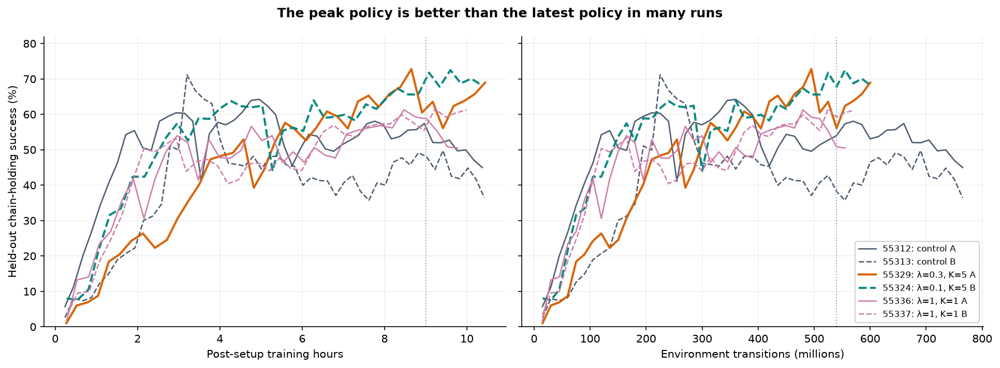
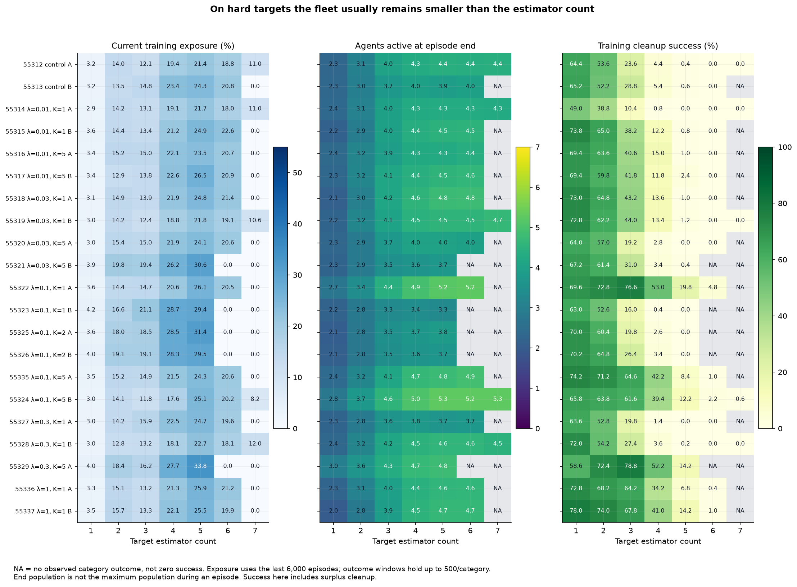
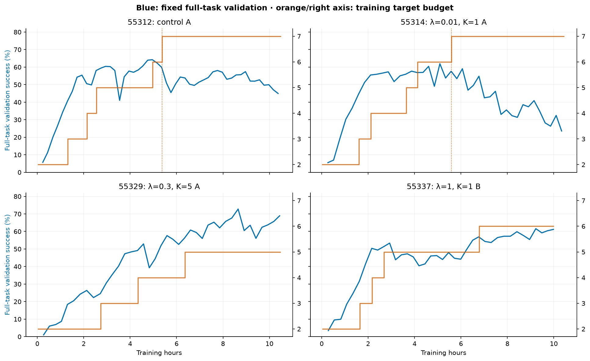
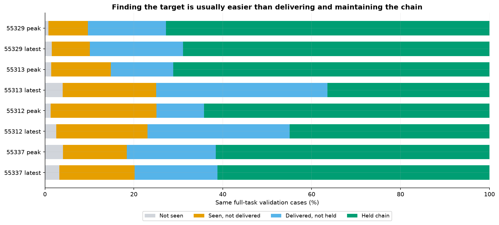
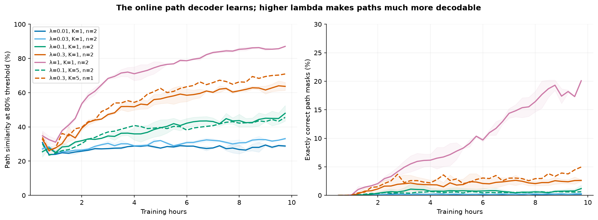
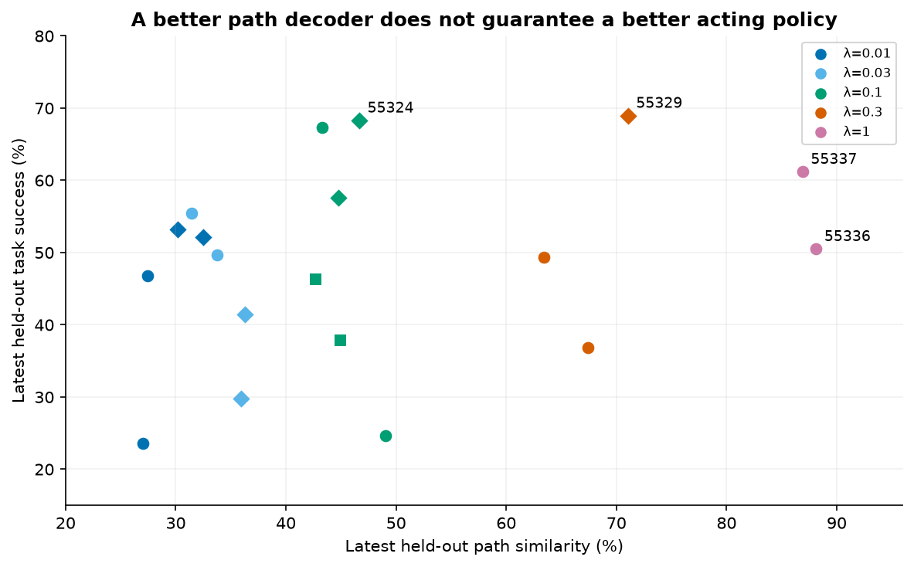
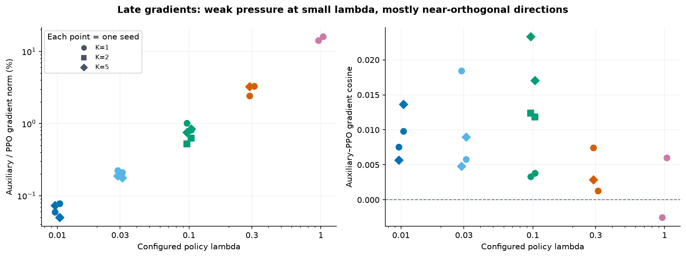
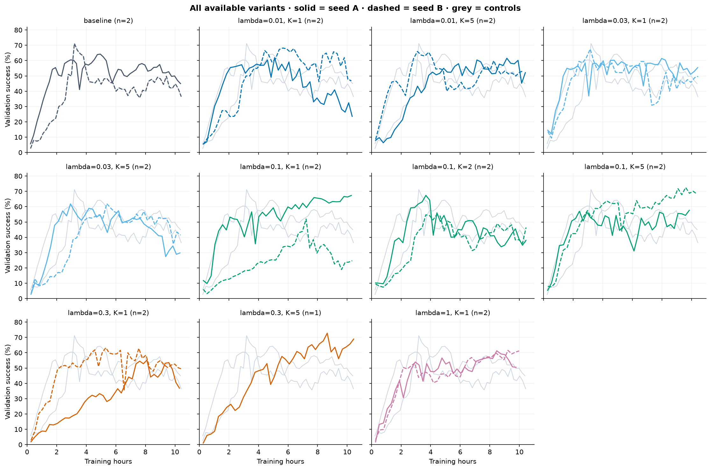

# G03 CLU path auxiliary loss — interim Auswertung

**Evidence snapshot: 2 November 2026, 11:32:02–11:32:21 CET.** The 21 trained runs were still running. Their saved budget is 43,200 seconds (12 hours), and the snapshot covers about 10–10.5 training hours per run. Values below are frozen for this report, not a live dashboard.

## Assessment

**My best explanation is a recruitment and coordination bottleneck, amplified by an overly permissive curriculum gate. The path auxiliary task improves path decodability, but does not resolve the limiting fleet-control decisions.** I would address those mechanisms before spending more slots on lambda sweeps or replacing the path mask with tokens.

This is supported by more than low success rates. In four runs with hours of seven-agent-target experience, the counters imply that **at least 69–88% of recent seven-agent-target episodes never deployed seven agents at all**. Those runs end such episodes with roughly 4.3–4.7 active agents and zero logged success. They usually fail before they can use a full-size team.

The decoder itself is learning: raising lambda from 0.01 to 1 raises paired K=1 held-out path similarity from **27.26% to 87.53%**. Yet the lambda=1 policies do not beat the controls on task success. There is also a concrete implementation limitation: **base-station memory is replayed as stored, detached data**, so the auxiliary gradient does not optimize senders through that base-memory communication route.

These observations locate the problem more specifically than “the GRU is too small” or “BCE did not learn.” The precise contribution of unanimous voting, delayed credit, and message transport is an inference rather than an isolated causal result. The priority ablations below distinguish those mechanisms with three focused changes.

## Best checkpoint for inspection

The strongest individual policy observed is **experiment 55329: lambda=0.3, K=5, seed 456789**, with **72.78% full-task held-out chain success** at update **1650 / 495 million environment transitions**. Its latest recorded validation is 68.94%. Selection uses task validation, not decoder score or training return.

I downloaded its immutable **ckpt_001650**, rather than the replaceable best-checkpoint directory, plus all three saved inspection maps. The fetched model and auxiliary head restored successfully on CPU. The head's saved supervision counter is 1650 and its effective lambda is 0.3. No training or inspection rollout was launched during this analysis.

The checkpoint is under:

```text
outputs/CLU_G03_aux_l0p3_k5_seed456789_geo_aux_v1/checkpoints/ckpt_001650
```

Run this from the repository root **in WSL**:

```bash
bash outputs/g03_auxiliary_analysis_20261102/inspect_best.sh
```

That script uses a prepared frozen `inspection_level.yaml`, preserving the auxiliary-head architecture. It evaluates the saved three-map suite with full-budget independent targets and generates replays by required-agent group on one map. It deliberately overrides the checkpoint's training target budget: the selected policy was still training at budget five, and restricting inspection to that budget would hide the hard cases. This small inspection suite does not reproduce the 400-map validation score.

Then open the inspector:

```bash
uv run swarmecho-inspect root=outputs/CLU_G03_aux_l0p3_k5_seed456789_geo_aux_v1
```

Run [55324](https://wandb.ai/ias_master_thesis_sk/swarmecho/runs/gspyuh0o) is close at 72.49%; [55329](https://wandb.ai/ias_master_thesis_sk/swarmecho/runs/xi4906pa) is the numerical winner, not an established statistically superior variant. Its second seed never trained because of the allocation failures. The winning checkpoint's ordinary case-level interval is 71.90–73.64%, which does not account for checkpoint selection or seed uncertainty.

## What the experiment does and does not show

There are **21 trained runs covering 11 variants**: ten paired variants and the single lambda=0.3/K=5 seed. Three intended combinations did not train: its second seed and both lambda=1/K=5 seeds. Failed allocations are not scored as learning failures.

The PPO setting is identical throughout: 6,000 environments, 50 rollout steps, three epochs and six minibatches. Frozen configurations differ only in seed, auxiliary enable/lambda/K and run/group names. Training maps, held-out maps and selection seeds agree. All allocation GPUs report NVIDIA A100-SXM4-80GB; nodes differ. There are no recorded OOM recoveries.

**Task validation** always uses the same 10,000 frozen cases on 400 held-out maps, with all seven agent slots available and the full target distribution. It measures chain holding. **Training success** additionally requires cleaning up surplus agents and uses an evolving target curriculum. These success rates must not be equated. A “seven-agent target” below is the global relay estimator's category, not a mathematical proof that no continuous-world chain with fewer agents exists.

Best-so-far scores at a common wall-time cutoff and scores at a common training-step count answer different questions. The table averages available seeds, except the explicitly unpaired lambda=0.3/K=5 row. “At 540 M” means the validation at update 1800, not its preceding best.

| Variant | Seeds | Best by 4 h | Best by 9 h | At 540 M steps | Latest path similarity |
| --- | --- | --- | --- | --- | --- |
| lambda=0.3, K=5 | 1 | 47.28% | 72.78% | 56.08% | 71.06% |
| baseline | 2 | 65.80% | 67.69% | 46.13% | — |
| lambda=0.01, K=1 | 2 | 56.39% | 65.06% | 51.57% | 27.26% |
| lambda=0.03, K=1 | 2 | 63.04% | 64.47% | 44.16% | 32.57% |
| lambda=0.01, K=5 | 2 | 58.17% | 63.19% | 56.42% | 31.34% |
| lambda=0.1, K=5 | 2 | 57.96% | 62.19% | 61.70% | 45.71% |
| lambda=0.03, K=5 | 2 | 56.33% | 61.88% | 46.49% | 36.11% |
| lambda=0.1, K=2 | 2 | 61.02% | 61.07% | 39.42% | 43.77% |
| lambda=1, K=1 | 2 | 53.68% | 60.57% | 55.01% | 87.53% |
| lambda=0.3, K=1 | 2 | 41.27% | 59.23% | 50.92% | 65.43% |
| lambda=0.1, K=1 | 2 | 39.68% | 58.95% | 42.96% | 46.17% |


**No paired auxiliary variant beats the controls' mean best score by nine hours.** The controls reach 67.69%; the strongest paired auxiliary result on that criterion is 65.06% for lambda=0.01/K=1. At four hours the controls are also stronger. Some K=5 variants retain substantially better policies later: at matched 540 M transitions, lambda=0.1/K=5 averages 61.70% versus 46.13% for the controls. That is a useful stability signal, not evidence that it has the best attainable task score.



## Evidence for the bottleneck

### 1. Most hard episodes never assemble the designed fleet

Only five runs have completed any group-seven training episodes. The other sixteen have not yet reached that target distribution; missing group-seven scores are not zero scores.

| Run | Variant / seed | Hours since first completed group-7 episode | Group-7 share now | Group-7 success | Group-7 end population | At least never deployed seven |
| --- | --- | --- | --- | --- | --- | --- |
| 55319 | λ=0.03, K=1 B | 3.85 | 10.62% | 0.00% | 4.65 | 68.60% |
| 55312 | control A | 5.06 | 11.03% | 0.00% | 4.39 | 87.31% |
| 55324 | λ=0.1, K=5 B | 0.03 | 8.17% | 0.61% | 5.26 | 10.00% |
| 55314 | λ=0.01, K=1 A | 4.77 | 11.00% | 0.00% | 4.28 | 81.21% |
| 55328 | λ=0.3, K=1 B | 2.83 | 12.05% | 0.00% | 4.51 | 87.55% |


The last column is a conservative bound from existing counters, not an assumption based on the terminal population. All episodes start with one agent. Reaching seven simultaneously requires at least six recruitment calls. Both the “six or more calls” rate and group-seven exposure use the same ordinary 6,000-episode window.

For example, in control 55312 **11.03%** of recent episodes are group seven, but only **1.40%** of all episodes made at least six recruitment calls. Even assigning every call-heavy episode to group seven, at most **12.69%** of group-seven episodes could have reached seven agents. Therefore at least **87.31% never did**. Replacement calls only make this upper bound more conservative.

This is a stronger diagnosis than “their final population was low.” The latter could also result from removals late in an episode. Here the call count rules out a full fleet for most hard episodes. Decommissioning is also modest: the long-exposed failing runs average about 0.19–0.33 removals per episode overall, whereas they average only 3.3–3.5 calls from one starting agent. Frequent grant rejection is not the main signal either; rejected calls are very rare.

The newly advanced 55324 is different: it has only minutes of group-seven exposure and approximately 3 successes in a still-partial 490-episode category window. Its 0.61% should not be presented as a stable multi-hour plateau. The persistent zero-success result is much better supported in the other four runs.



**Most likely mechanism:** recruiting another drone becomes a coordinated, delayed decision as the fleet grows. The configuration requires qualified YES decisions from **every active agent**, held for three steps. One missing or NO decision can prevent recruitment. The 50-step recurrent PPO replay, delayed benefit of an extra relay, per-agent time cost and asymmetric call penalties make this harder to learn. The logs establish insufficient recruitment; they do not reveal which individual voter or communication hop vetoed each call. I therefore regard unanimous-vote/credit-assignment failure as the leading mechanism, not a proven implementation bug.

### 2. The curriculum can advance while the hard category remains unsolved

The gate does **not** measure mastery of the newly added category. Submitted `TargetBudgetCurriculum.observe_curriculum` selects **all cases with required count <= current budget**, averages them, and advances at 75% success after one passing inspection. The inspection population is three fixed maps, not the 400-map validation population.

Consequently, a rare hard category can fail almost completely while easier cases carry the average over the threshold. On observed 6→7 transitions:

| Run | Inspection gate success | Concurrent training group-six success |
| --- | --- | --- |
| 55312, control A | 75.83% | 0.00% |
| 55314, lambda=0.01/K=1 A | 75.60% | 0.40% |
| 55319, lambda=0.03/K=1 B | 75.70% | 1.40% |
| 55328, lambda=0.3/K=1 B | 75.53% | 1.80% |
| 55324, lambda=0.1/K=5 B | 76.20% | 3.20% |

The two columns have different populations and success definitions, so they do not establish the exact inspection group-six success. They do show why a gate pass cannot be read as mastery of the hard training category. This creates misleading stage progress and allows difficult missions to expand before the fleet-control behavior needed for them is established.

There is real policy deterioration, not just a harder displayed training average: the validation cases never change. Control 55313 falls from **71.16% to 36.44%** on those same cases; 55314 falls from **61.93% to 23.56%**. Curriculum changes plausibly contribute, but do not explain every oscillation: the winning run also fluctuates while remaining at budget five. Treat the gate as a weak progression criterion and the regression as a wider control/optimization stability problem.



### 3. Discovery is usually better than chain completion

At the winning checkpoint, **99.23%** of validation targets are seen, **90.31%** are delivered to the base, and **72.78%** produce a held chain. The initial target search is therefore not the dominant aggregate failure stage at that checkpoint. Failures accumulate during information delivery and sustained chain formation.

This does not prove that every seven-agent target is discovered: the saved validation scalars are not broken down by estimator category. It does make a broad “they cannot find the target” explanation less convincing than a recruitment/coordination explanation. Training-only cleanup penalties cannot by themselves explain weak validation, because validation scores chain holding without requiring surplus cleanup.



## Is the probe learning, and are the GRUs more structured?

**The probe is learning substantially, especially when its gradient is allowed to shape the GRU strongly.** The following paired K=1 results use the same decoder architecture, learning rate, target representation and threshold:

| Lambda, K=1 | Seeds | Latest similarity | Latest soft overlap | Exact masks | Late auxiliary/PPO norm |
| --- | --- | --- | --- | --- | --- |
| 0.01 | 2 | 27.26% | 54.37% | 0.18% | 0.069% |
| 0.03 | 2 | 32.57% | 57.45% | 0.36% | 0.217% |
| 0.1 | 2 | 46.17% | 62.82% | 0.80% | 0.916% |
| 0.3 | 2 | 65.43% | 72.28% | 3.09% | 2.868% |
| 1 | 2 | 87.53% | 87.98% | 21.29% | 15.134% |


The local BCE objective also decreases, roughly from 0.61–0.65 initially to about 0.024 for lambda=1. I use held-out path similarity to interpret this, rather than treating the BCE scalar as a practical performance score. The improvement is not just correct empty cells: both path-overlap scores ignore correctly empty cells.

There are important limits to the apparent success. At lambda=1, **87.53% path similarity still means only 21.29% exactly correct masks** at the configured 80% threshold. The winning acting policy, lambda=0.3/K=5, has 71.06% latest path similarity but only 4.43% exactly correct masks. This is useful approximate path information, not uniformly precise route reconstruction.



The head is trained only on active informed agents, and validation selects an informed snapshot per eligible agent. Its score is conditional on reaching that state. The latest fetched journals score 9,834/10,000 episodes for 55329 and 9,480–9,661 for the lambda=1 runs, so these are not scores on a tiny easy subset, but their trajectories and eligible agents still differ. Each path metric averages agents within episodes and then episodes.

**The GRUs are demonstrably path-decodable, but this study does not directly prove that they are more structured than the policy-only GRUs.** Controls have no online head, so there is no matched control decoding score. The strong dose response within auxiliary runs supports the narrower claim that path supervision organizes features for this decoder. It does not establish a general improvement in representation quality, message quality, role assignment or acting ability.

The dissociation is visible in the task scores: the lambda=1 pair has the best decoding but a lower mean peak task score (61.42%) than the controls (67.69%). An agent can encode a useful path yet fail to obtain enough teammates, choose its own relay position or hold the formation.



### The effective pressure is much smaller than the nominal lambda suggests

All auxiliary runs have completed warm-up and ramp-up; the schedule is not stuck at zero. They process thousands to tens of thousands of valid new snapshots per update. The selected checkpoint, for example, restores a fully ramped lambda of 0.3 and 1650 supervised updates. Snapshot shortage is not a convincing general explanation.

Late median auxiliary/PPO gradient norms on the shared representation are approximately **0.07%** at lambda=0.01, **0.22%** at 0.03, **0.92%** at 0.1, **2.87%** at 0.3 and **15.13%** at 1 for the paired K=1 runs. Thus most small-lambda variants apply very weak representation pressure. Lambda=1 is a unit loss coefficient, not equal gradient strength.

Median gradient cosines are close to zero, generally slightly positive. There is no strong observed negative-alignment signal supporting “the two losses simply fight each other.” Near-zero sampled cosines do not guarantee absence of interference. These are raw norms before clipping/Adam, not percentages of the optimizer's actual parameter update.



### A real gradient limitation in base-station communication

The submitted PPO replay recomputes agent hidden states and carries newly emitted peer signatures/values through the recurrent scan. But `base_signatures`, `base_values` and `base_memory_masks` come directly from the stored minibatch at every replayed step. The scan does not reconstruct base-cache updates using the current sender's emissions.

**Therefore a loss on a base-message recipient cannot backpropagate through that stored base message into the sender's message encoder.** This is more than the normal detached initial GRU at a rollout boundary: the base inputs remain stored constants throughout the replayed rollout. The auxiliary can still train recipient GRUs, directly supervised senders and peer-message paths inside the unroll. It cannot deliver the intended end-to-end message-learning signal through the base-memory route.

This limitation also affects the common PPO communication replay, so it is a credible shared bottleneck, not an explanation unique to one lambda. It does not prove that base messages are unusable or that this alone causes the failures. It does mean we should not claim that these experiments fully optimize information transmission through the base station. Reconstructed peer communication and reconstructed base communication are currently different cases.

## Explanations I would not prioritize

- **OOM or silently changed scientific batches:** no recovery retries were recorded, and the PPO settings match across trained runs.
- **A completely non-learning auxiliary decoder:** contradicted by the held-out overlap and exact-mask trends.
- **Insufficient time for warm-up:** contradicted by the recovered supervision counter and long fully ramped trajectories.
- **A broad target-discovery failure:** contradicted by near-99% visual discovery at strong checkpoints; this remains possible for particular hard cases, not the best aggregate explanation.
- **Cleanup churn as the sole cause:** removals are too infrequent to explain the observed fleet deficit, and validation does not require cleanup.
- **Missing reference routes as the main explanation:** the fixed validation label cache reports only 16 missing routes among 10,000 unique requests. Training logs contain route failures too, but they skip auxiliary labels only; they cannot explain the same recruitment failure in policy-only controls.
- **A need to replace BCE or masks with sequence tokens immediately:** current supervision already changes the representation strongly. It does not directly supervise recruitment or relay-role decisions. Changing the output format would not address the clearest observed failure.

## Three ablations worth spending slots on

I would keep PPO fixed and use the same two seeds, with auxiliary disabled for the initial recruitment controls so its effects do not obscure the mechanism. These are prioritized controls, not another broad grid search.

### 1. Supply the seven-agent fleet automatically

**First choice if only one ablation is possible.** Start with seven reserved agents, released with the ordinary spawn delay, prevent decommissioning, train on the full target distribution, and score chain holding. Use the chain-holding training objective and neutralize surplus/call/cleanup shaping, otherwise a fixed surplus population would make many easier cleanup tasks impossible.

This intentionally bundles recruitment and cleanup removal as a diagnostic upper-bound control, not a clean test of one quorum parameter. If six/seven-category success rises sharply, the movement/formation policy can solve the task once a fleet is supplied: recruitment/lifecycle control is the limiting layer. If it stays near zero despite a full fleet, role assignment, connectivity maintenance and long-range control need to move above recruitment in the priority list. This has a much clearer interpretation than adding more lambda values.

### 2. Keep learned recruitment, replace unanimity with strict majority

Change only `adapt_size.quorum_fraction` from 1.0 to **0.5**; the implementation uses strict `>` for fractional quorums, so this is a strict majority. Preserve spawn delay, three-step hold, task rewards and seven available slots. Compare against the matching policy-only controls.

The expected mechanism-specific result is more call-heavy episodes, a smaller group-seven fleet deficit and higher hard-category success. If call rates rise but chain success does not, unanimous voting was suppressing deployments but was not the whole control bottleneck. Rejected-call counts should remain an outcome to watch rather than adding another reward change at the same time.

### 3. Reconstruct base memory inside differentiable recurrent replay

Carry base validity/signature/value through replay and recompute cache writes from current sender emissions at the recorded communication events. Detach only the rollout's initial cache. Keep the actual environment and sampling schedule unchanged. This tests the concrete gradient disconnect found above.

Compare the existing implementation with the corrected replay at one fixed auxiliary setting, preferably lambda=0.3/K=5 after the recruitment control is understood. Success would be better downstream information delivery/coordination and task success, not merely a stronger sender-side path decoder. This requires code work; it is not achieved by increasing K or lambda.

**Curriculum change to make alongside interpreting those experiments:** stop treating the <=budget average as evidence that the newest category is mastered. Gate on the current hardest category with adequate support from a representative fixed population. The existing 400-map validation already provides a suitable population; its outcomes would need the required-count breakdown retained. This repairs the progression criterion. It is not a promise that freezing at the unsolved category alone teaches the missing recruitment behavior.

## Compute cost and run stability

Auxiliary runs deliver fewer environment updates per wall hour. At the common 540-million-transition checkpoint:

| Variant | Hours to 540 M steps | Observed time vs controls |
| --- | --- | --- |
| baseline | 7.39 | reference |
| lambda=0.01, K=1 | 8.99 | +21.7% |
| lambda=0.01, K=5 | 9.21 | +24.6% |
| lambda=0.03, K=1 | 8.97 | +21.4% |
| lambda=0.03, K=5 | 9.14 | +23.7% |
| lambda=0.1, K=1 | 9.08 | +22.9% |
| lambda=0.1, K=2 | 9.00 | +21.8% |
| lambda=0.1, K=5 | 9.21 | +24.6% |
| lambda=0.3, K=1 | 9.05 | +22.4% |
| lambda=0.3, K=5 | 9.42 | +27.5% |
| lambda=1, K=1 | 9.51 | +28.7% |


The observed slowdown is about **21–29%** in this cohort. This includes decoder work, recurrent gradient capture, host labels, diagnostics and evaluation; it is not an isolated neural-head benchmark. GPUs have the same model, but shared node/CPU/IO conditions were not controlled. K=5 adds relatively little over K=1 at comparable lambda, consistent with reusing the main recurrent replay rather than rerunning five policy sequences.

Large task regressions are present even without auxiliary loss. Late median KL, clipping and critic errors do not show an obvious optimizer explosion that explains the fleet-count pattern. Aggregate diagnostics still cannot exclude poor value/advantage estimates on rare hard trajectories. I would not repeat the broad PPO-count search before testing the recruitment and communication mechanisms above.

## Evidence and reproducibility

- Full W&B scalar histories and diagnostic series were downloaded, not chart screenshots or downsampled display traces. All returned history row counts match the advertised counts at fetch; all are below the API sample ceiling.
- All **875** W&B validation observations match their PFSS validation-journal scores exactly at the same global step. The same map selections and validation identity are used throughout.
- Raw histories, Determined states/log tails, read-only PFSS scalar exports and scripts are under `outputs/g03_auxiliary_analysis_20261102/`. Two temporary zero-GPU transfer shells were released. No existing runs were stopped, restarted or submitted.
- The published checkpoint import is 40 files / about 45.8 MiB including its dependencies, with no conflicts or deferred changing files. Model restoration, head counter, lambda, step history and three-map availability were verified locally. No new rollout/evaluation score was substituted into the report.
- [Run-level statistics](data/run_summaries.csv), [paired variant statistics](data/variant_summaries.csv), [all validation observations](data/validation_series.csv), [dataset checks](data/dataset_checks.json), [configuration differences](data/config_differences.json), [submitted-source excerpts](data/source_evidence.json), and [checkpoint verification](data/checkpoint_verified.json) accompany this report.
- Main source locations: `training/adapt_size_metrics.py` for the synchronized ordinary/category windows; `training/adaptive_spawn.py:53–79` for the <=budget gate; `env/adapt_size.py:393–421` for quorum and grants; `training/ppo.py:47–83` for peer replay and stored base inputs. The submitted code for these mechanisms matches the inspected working-tree code.

The validation cases were repeatedly inspected and used to select the checkpoint, so its peak is a selection score, not an untouched final-test estimate. Two seeds do not support strong significance claims, and the top variant has only one. The recruitment bound is stronger evidence than the ranking: it follows directly from synchronized counts and remains valid even if the relative ranking changes before the runs finish. Also, 55324 has only just encountered completed group-seven episodes; its remaining time may still change that specific conclusion.

## Appendix: every variant's raw task curve


