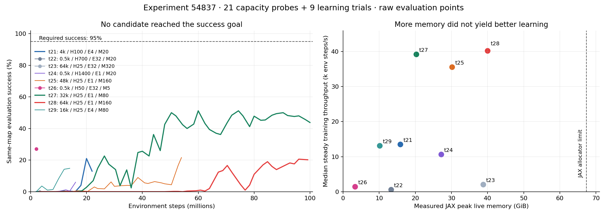
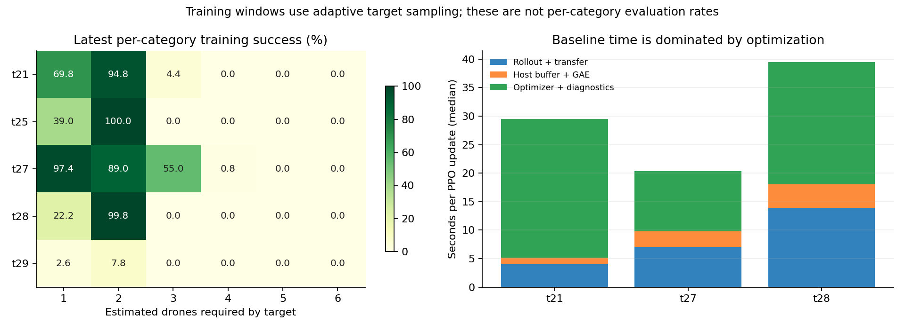

# 2026-10-29 — experiment 54837: G01 no-curriculum capacity and PPO review

> Historical report. For the current cluster PPO tuning conclusions, see [the four-wave G03 report](../g03_refinement_analysis_20261031/G03_refinement_report.html).

Follow-up update: the proposed no-curriculum comparison in section 6 was
superseded by the user's virtual-target-curriculum local/cluster comparison,
which keeps seven recruitment slots available from the beginning. See
[the current comparison guide](../../../docs/02_guide/09_G01_local_cluster_curriculum_comparison.md).
The measurements and findings below remain the historical experiment record.

**The study did not identify a configuration that solves the requested task.**
It established useful hardware limits and a throughput plateau, but the learning
comparison was undermined by unequal trial budgets, extreme startup samples,
and the absence of a completed reference run. Calling a 51.2% peak a winning
training configuration would be unjustified. The search design was my mistake.

This review uses all 379 fetched PFSS files, all nine W&B histories, 154 scalar
evaluation observations, per-update timings, telemetry, historical local G01
configuration snapshots, and a separate CPU geometry audit of 10,000 target
positions. No new GPU training was submitted or run.

## 1. What actually ran

- One NVIDIA A100-SXM4-80GB, 80 GiB physical memory.
- JAX's 85% preallocation produced a measured allocator limit of 67.38 GiB.
- 21 capacity probes: 13 completed, seven genuine OOMs, one capacity-stage timeout.
- Nine learning runs: two reached the step limit, seven were killed by study budgets.
- **No learning run had a recorded OOM, numerical failure, or independent worker error.**
- No learning run achieved the confirmed 95% goal.
- Capacity consumed 60 minutes; the first six learning runs consumed 30 minutes
  each; two later runs consumed approximately 50 minutes each; the last received
  the remaining 20.5 minutes. This accounts for the six-hour allocation.

The 30-minute worker budgets include setup. W&B starts later, explaining the
29m30s–29m31s dashboard runtimes. The controller used SIGKILL at its deadline,
preventing orderly `wandb.finish()`, and W&B consequently says “Crashed”.
Filtering to W&B “Finished” hides seven valid but censored learning records.
Their recorded data remains useful; their endpoints are not convergence failures.

The later runs were permitted up to 90 minutes, but finished because they hit
100M steps (99.2M for the non-divisible 1.6M batch). They were not promoted
continuations of earlier runs. All nine started fresh.

## 2. Learning results

Tuple order is **envs / rollout horizon / PPO epochs / minibatches**.
Throughput is median warm training throughput, excluding scalar evaluation,
cold startup and final artifacts. Times include the entire worker attempt.
Peak memory is JAX live allocation, not `nvidia-smi` reservation.

| Trial | Tuple | Runtime | Env steps | PPO updates | Eval checks | Best / last eval success | Warm env steps/s | Peak GiB | End reason |
|---|---|---:|---:|---:|---:|---:|---:|---:|---|
| 21 | 4000 / 100 / 4 / 20 | 30.0m | 22.0M | 55 | 11 | 21.0% / 13.0% | 13,537 | 15.82 | Startup budget |
| 22 | 500 / 700 / 32 / 20 | 30.0m | 0.7M | 2 | 0 | Not evaluated | 586 | 13.25 | Startup budget |
| 23 | 64000 / 25 / 32 / 320 | 30.0m | 3.2M | 2 | 1 | 0.0% / 0.0% | 2,047 | 38.76 | Startup budget |
| 24 | 500 / 1400 / 1 / 20 | 30.0m | 17.5M | 25 | 8 | 6.0% / 6.0% | 10,698 | 27.12 | Startup budget |
| 25 | 48000 / 25 / 1 / 160 | 30.0m | 54.0M | 45 | 27 | 21.6% / 21.6% | 35,570 | 30.16 | Startup budget |
| 26 | 500 / 50 / 32 / 5 | 30.0m | 2.5M | 100 | 1 | 27.0% / 27.0% | 1,482 | 3.29 | Startup budget |
| 27 | 32000 / 25 / 1 / 80 | 49.9m | 100.0M | 125 | 50 | **51.2% / 43.8%** | **39,250** | 20.23 | Step limit |
| 28 | 64000 / 25 / 1 / 160 | 49.4m | 99.2M | 62 | 49 | 20.6% / 20.2% | 40,208 | 39.99 | Step limit |
| 29 | 16000 / 25 / 4 / 80 | 20.5m | 14.0M | 35 | 7 | 14.8% / 14.8% | 13,148 | 10.14 | Global deadline |

At the common 30-minute point, trial 27 had already peaked at 50.0%, with its
latest evaluation at 42.8% and 58.4M steps. Trial 28 was at 0.4% on its latest
56M-step evaluation, and trial 25 at 21.6% on 54M. Thus the 32k result has a
meaningful advantage within the large-env/short-rollout group, even before
considering its longer total runtime. This is one-seed evidence, not a reliable
global ordering of PPO configurations.

The reference's 21% at 22M cannot fairly be compared with trial 27's 51.2% at
60M as evidence of better sample efficiency. The reference was never allowed
to reach the same step count. Its 30-minute time efficiency was lower, but
its eventual convergence remains unknown.

Trial 26's 27% is based on a single evaluation. Its 32 epochs made it roughly
nine times slower than the reference and 26 times slower than trial 27 in warm
throughput. That isolated success value does not make it an attractive winner.
Trial 29 is also too censored to judge its eventual learning quality.

**51.2% is evaluation episode success on 500 sampled target positions. It does
not mean exactly 51.2% of physical map volume was solved or explored.**

## 3. Map, seven-agent capacity, and historical G01

The submitted snapshot and every learning output identify
`B02c_static_map_noSpawn`: the authored 15 × 15 × 15 m G01 building, fixed base,
three storeys. Geometry was not randomized. Targets were sampled within this
fixed building. Training used adaptive target sampling; scalar evaluation used
the same map and fixed seeded evaluation batch, without training's changing
cell probabilities. All nine retained all 23 eligible target cells at startup.

Every learning run had seven recruitment slots, started with one active drone,
and had the agent-count curriculum disabled. `req_agent_7` instead describes
targets whose current estimator says they require exactly seven drones.
It does not count “runs configured with seven drones”.

All completed-episode W&B windows report zero requirement-7 exposure. A separate
uniform legal-volume CPU audit, using the same current map, 166 roadmap vertices,
383 global radio candidates and communication/vision ranges, produced:

| Estimated required drones | Targets out of 10,000 |
|---|---:|
| 1 | 404 |
| 2 | 3,564 |
| 3 | 1,923 |
| 4 | 1,080 |
| 5 | 1,340 |
| 6 | 1,689 |
| 7 | 0 |

This supports the observed absence of requirement 7; it is not a proof over
continuous space. It provides no reason to suspect that the seven-agent cap
was silently reduced. Requirements depend on current geometry and estimator,
not just straight-line base-to-target distance.

The best run's latest per-category training windows were:

| Requirement | Success | Share of ordinary completed-episode window |
|---|---:|---:|
| 1 | 97.4% | 1.1% |
| 2 | 89.0% | 11.3% |
| 3 | 55.0% | 17.8% |
| 4 | 0.8% | 17.9% |
| 5 | 0.0% | 23.0% |
| 6 | 0.0% | 28.8% |

Per-category successes use separate 500-episode histories; exposure uses the
ordinary env-count-sized window. These columns therefore cannot be multiplied
to reconstruct the overall training success rate. They clearly locate the
failure: harder relay chains, rather than inability to recruit any agents.
Adaptive sampling increasingly emphasized unsolved cells, helping explain
training success below the ordinary same-map evaluation success.

The local historical controls are materially different:

- `G01_static_targetVisual_adaptiveSpawn`: 99.9% at 75.3M steps, but adaptive
  recruitment was **disabled**; all drones were available under the old task.
- `G01_agent_curriculum_newWorld_agents_7`: 98.6% at cumulative 295.8M steps,
  continuing the six-agent checkpoint after several curriculum stages.
- CLU uses current G03 rewards, latest-decision voting, different quorum and
  observation settings, no reference reward, and fresh full-cap recruitment.

Those successful records establish that the geometry can be solved. They do
not establish that this current, harder fresh recruitment task converges within
100M steps. I should have made that distinction explicit before the search.

## 4. PPO updates versus sparse training curves

One rollout/PPO update contains `num_envs × num_steps` **environment transitions**;
the seven-agent dimension is additional work, not another multiplier in the
logged environment step count. The learning batches ranged from 25,000 to
1.6M transitions. None updated only once per 20M transitions.

| Trial | Transitions per PPO update | First full training episode window |
|---|---:|---:|
| 21, reference | 0.4M | 2.8M steps |
| 25, 48k envs | 1.2M | 33.6M steps |
| 27, 32k envs | 0.8M | 22.4M steps |
| 28, 64k envs | 1.6M | 44.8M steps |
| 29, 16k envs | 0.4M | 11.2M steps |

Normal training and requirement metrics wait for a full completed-episode
window of size `num_envs`. The mostly unsuccessful initial episodes last 700
steps, yielding approximately `700 × num_envs` aggregate transitions before
that window fills. PPO losses and update counters are present earlier.
Trial 27 did 28 updates before its first full training window; trial 28 also
did 28, despite twice as many aggregate steps.

At 100M steps, 32k envs experienced approximately 3,125 transitions per lane;
64k only 1,550. The latter also received half as many PPO updates. That is a
substantial change in learning and adaptive-sampler feedback, despite similar
throughput. It is a plausible contributor to the weaker result, not a proven
single cause.

The custom W&B wall-time axis was my added override. It has now been removed
from the worker: ordinary metrics retain the explicitly logged environment
step, while `perf/wall_seconds` remains available separately. Existing finished
runs and saved dashboard panels have not been rewritten. These report figures
already display the downloaded results against environment steps.

## 5. Hardware findings we can use

These are two-update all-seven-active stress probes, not converged learning
benchmarks. Their warm throughput estimates contain only one post-cold update.

| Shape, epochs=1 | Observed fit / failure | Warm throughput | JAX live peak |
|---|---|---:|---:|
| 4000 × 100, M20 | Fit | 32.5k/s | 15.49 GiB |
| 4000 × 100, M5 | Fit | **47.8k/s** | **49.35 GiB** |
| 8000 × 100, M20 | Fit | 41.0k/s | 30.93 GiB |
| 8000 × 100, M80 | Fit | 26.5k/s | 13.65 GiB |
| 8000 × 100, M5 | OOM before completed update | — | Failure peak incomplete |
| 20000 × 100, M40 | Fit | 39.6k/s | 48.36 GiB |
| 24000 × 100, M40 | OOM during second update | — | Failure peak incomplete |
| 96000 × 25, M160 | Fit | 48.6k/s | 58.12 GiB |
| 128000 × 25, M160 | OOM during second update | — | Failure peak incomplete |
| 4000 × 400, M40 | Fit | 25.4k/s | 37.90 GiB |
| 6000 × 400, M40 | OOM during second update | — | Failure peak incomplete |
| 2000 × 700, M40 | Fit | 17.0k/s | 33.03 GiB |
| 1000 × 1400, M40 | Fit | 11.3k/s | 33.00 GiB |

The 5000 × 400 boundary candidate was killed at the capacity-stage deadline
before completing an update; it is **not** evidence of OOM. The brackets above
are shape-specific. They do not imply one universal maximum batch size.

Main implications:

1. **Memory capacity substantially exceeds the 4090 operating point.** At H100,
   M40, 20k envs fitted; 24k failed. At H25, M160, 96k fitted and 128k failed.
2. **Filling that memory is not itself faster.** Completed learning at 32k versus
   64k used 20.23 versus 39.99 GiB and achieved 39.25k versus 40.21k warm steps/s.
   Including startup/evaluation/final work, both delivered about 33.4k steps/s.
3. **Minibatch size is a promising use of memory without multiplying parallel
   episodes.** At the same 4000 × 100 rollout and one epoch, M5 was 47% faster
   than M20, using 49.35 instead of 15.49 GiB. M5 increases the size of each
   recurrent minibatch and reduces the number of optimizer calls.
4. **Baseline optimization dominates:** median 24.33s optimizer/diagnostics,
   4.12s rollout/transfer, 1.08s host buffer/GAE, 29.55s total per update.
   Merely making rollout larger leaves the dominant cost in place.
5. **Huge horizons cost real recurrent replay time.** Similar 1.4M-transition
   batches at H700 versus H1400 used similar peak memory but achieved 17.0k
   versus 11.3k/s. The H1400 learning trial did not show a compensating gain.
   This does not rule out moderate H100–400 alternatives.
6. **32 epochs were uneconomic here.** One candidate made 10,240 minibatch
   optimizer calls per PPO update and completed only two updates in 30 minutes.
   Pruning required ten updates, so the search could not reject it promptly.
7. `nvidia-smi` memory largely reflects the preallocated pool, not live model
   demand. Capacity OOM peaks are lower bounds measured before the failed
   allocation; they cannot be subtracted from 80 GiB to infer free headroom.

There is also a stability caution: the M5 capacity probe's second-update
approximate KL was 0.646, versus 0.050 for M20. This was the all-active stress
workload, not the normal recruitment task, and is only one update. It means
the fast M5 result is a **candidate to validate**, not a safe automatic default.
The reference's first learning update also had an anomalous KL (~974), followed
by a warm median ~0.014. This deserves visibility but does not establish a
numerical bug or explain the later learning plateau by itself.

## 6. One focused follow-up proposal

I recommend **two fresh full runs**, not another adaptive search:

| Run | Envs | Horizon | Epochs | Minibatches | Batch/update | Minibatch env transitions |
|---|---:|---:|---:|---:|---:|---:|
| A: untouched reference | 4000 | 100 | 4 | 20 | 400k | 20k |
| B: larger GPU minibatches | 4000 | 100 | 4 | 5 | 400k | 80k |

This selects the strongest directly measured hardware opportunity while
preserving the reference's horizon, rollout batch, parallel episode count and
four passes over each transition. It changes the minibatch count from 20 to 5:
20 versus 80 optimizer calls per rollout. That change can alter optimization
quality, which is exactly what the full convergence comparison must measure.
Increasing memory use is a secondary aim, not the success criterion.

The expected B memory footprint is around the measured 49 GiB E1/M5 footprint;
epochs are repeated sequentially, so four epochs should not multiply that
footprint by four. This is an estimate, not a long-run fit guarantee. The
all-active probe leaves roughly 18 GiB below the existing allocator limit.

Protocol:

- Same current CLU task, fixed seed, gamma 0.99, lambda 0.95, fixed map/base,
  initial population one, seven recruitment slots, no agent curriculum.
- Same deterministic 500-lane evaluation every 2M env steps, 95% twice
  consecutively; report step at goal and elapsed seconds at goal.
- Both finish at confirmed 95% or 100M env steps. **No 30-minute cutoff, no
  six-hour search clock, no pruning, no automatic extra candidates.**
- One submission should execute exactly these two configurations sequentially,
  one GPU at a time. Both have their own ordinary W&B run with environment
  steps on the x-axis; final artifacts only, normal orderly run completion.
- Record live JAX peak, GPU activity and timing components. Keep ordinary
  PPO/critic/KL curves and explicit completion reason, without creating more
  dashboard groups of speculative sweep metrics.
- Retain OOM/error isolation. A real error is reported as an error; reaching
  the step limit is finished but not converged. No silent parameter reduction.
- A four-hour allocation safety ceiling covers an unexpectedly slow or stuck
  workload. Normal runs should finish before it. Request an orderly stop with
  time for saving/finalization before that ceiling; if it is needed, label the
  affected result budget-exhausted and censored. It is not a target runtime,
  not an adaptive startup budget, and not evidence of failed convergence.

Reference full-budget cost projects to roughly **2h10m–2h20m** from measured
throughput and evaluation overhead. B is provisionally **50–80 minutes**;
four-epoch M5 performance has not been measured, so its estimate is wider.
Plan for about **3–3.5 hours total**, shorter if either reaches 95%. This is an
estimate, not a timer that kills unfinished runs. Two full 100M-step runs cannot
honestly be promised within one hour on the observed throughput.

The existing 32k/H25/E1/M80 result remains the historical throughput/learning
reference; spending another 50 minutes reproducing its 44% endpoint would not
answer the unresolved question. The proposed change instead uses the A100
memory to make the original, locally successful rollout layout cheaper.

Decision rule: prefer the configuration reaching confirmed 95% sooner; if only
one reaches it, that is the usable choice regardless of memory use. If neither
does within 100M, **do not claim a fastest-converging winner**. We then know that
the current no-curriculum recruitment task has not reproduced the older local
benchmark; a further blind hardware sweep would not be justified. This study
cannot guarantee that one more PPO comparison will solve that task.

This is a proposal. No follow-up training was submitted, and the historical
W&B runs or project dashboards were not modified.

## Evidence and reproducibility

- `../tuning/results.csv`: every capacity and learning result.
- `../tuning/summary.json`: controller configuration, stage receipts and results.
- `measurements.json`: per-trial timing, steps, memory and scalar evaluation points.
- `wandb_t021.json` … `wandb_t029.json`: read-only W&B history snapshots.
- `target_audit.json`, `audit_targets.py`: independent CPU target-support audit.
- `historical_g01.json`: historical local configs and final evaluations.
- `inspect_results.py`, `plot_results.py`: CPU-only report calculations and figures.
- [W&B axis documentation](https://docs.wandb.ai/models/track/log/customize-logging-axes)
  explains the removed `define_metric(..., step_metric=...)` override.
- [PPO reference](https://spinningup.openai.com/en/latest/algorithms/ppo.html)
  describes the distinct roles of collected experience, optimizer iterations,
  and KL monitoring. Candidate recommendations above come from this study's
  measurements, not an assumed universal PPO optimum.
