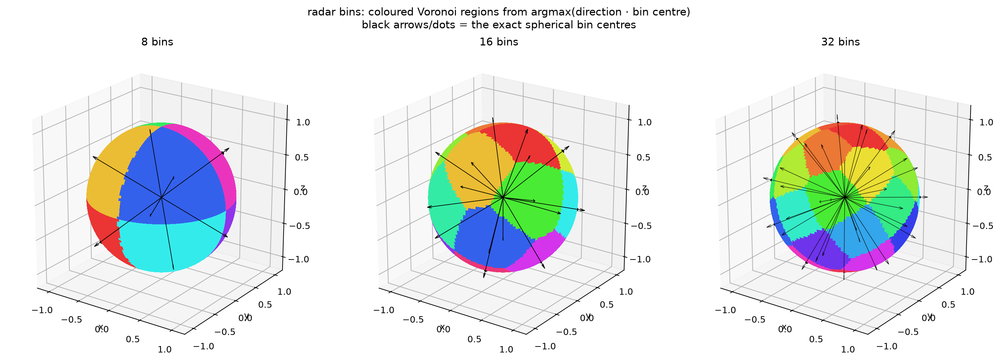

# 02 Environment and physics

## Building representation

The building format `swarmecho-map/v1` describes a regular three-dimensional cell grid with shared faces. `x_walls`, `y_walls` and `tiles` describe walls and horizontal slabs on cell boundaries. Doors and windows annotate wall openings. Explicit interior cells let a map exclude exterior portions of its bounding box. Stairs connect storeys through floor openings. The compiler turns this structure into collision solids, spawn volumes and planning data. [Building compiler](../src/swarmecho/env/buildings.py) · [Editor and format handling](../src/swarmecho/curriculum_config/maps/scripts/maze_builder/building_builder_core.py)

Door width, door height and window height are derived from cell size using the format's shared opening dimensions. Stairs use eight treads and an explicit horizontal orientation. These dimensions determine both flight clearance and visibility through a building. A door drawn in a map must leave enough clearance for the configured drone radius and planner margin.

G03's 15 × 15 m footprint, three storeys and 5 m cells produce a 3 × 3 × 3 building grid. Other dimensions use the same representation. A 20 × 15 m footprint with four storeys and 5 m cells gives a 4 × 3 × 4 grid. Generated footprints must be whole multiples of the cell size and at least two cells across each horizontal axis. Wall and tile thickness must be smaller than the cell edge. Authored buildings specify their own dimensions.

The random generator partitions each storey into rooms. Room bounds control that partition, required doors connect the room graph, and extra-door and window probabilities add openings. Stair placement needs legal entrances and floor openings. The generator places the base at a ground-floor corner-cell centre. `staircase_max` bounds stair connections between storeys. These constraints determine which combinations of dimensions and room settings can be generated. [Generator](../src/swarmecho/env/random_buildings.py)

### Authoring and validation

The browser editor edits interior volumes, walls, openings, tiles, roof, exclusions and spawn settings by storey. Placing a staircase creates its upper section and floor opening together. A staircase placed on the top storey adds the needed layer. Rotation changes its ascent direction, and removal clears both sections. Tiles can close an opening after stair removal. Full-cell-width stairs are supported, while existing maps retain their saved stair-width setting. [Editor](../src/swarmecho/curriculum_config/maps/scripts/maze_builder/index.html)

The map validator checks the building contract and geometry, including shared-face consistency and legal spawn space. Its optional `--runtime-smoke` also constructs and resets an environment in the project's Python/JAX runtime. The [README](../README.md#3-edit-a-3d-building) gives the launch and validation commands. A valid map file supplies geometry. Training still needs a level that selects it and defines the task. [Validator](../src/swarmecho/curriculum_config/maps/scripts/validate_building.py)

## Collision geometry and geodesics

`env.drone_radius` expands obstacles for collision checking. `env.obstacle_planning_clearance_m` adds a margin when preparing collision-free roadmap routes. Thus a passage can fit a point-sized visibility ray while remaining too narrow for a drone or its planner.

The free-space roadmap includes geometry-derived features around openings, stairs and wall ends, with sampled waypoints controlled by `env.roadmap_node_density`. `roadmap_merge_wall_end_nodes` merges suitable nearby wall-end features where the compiler's visibility checks permit it. The graph connects legal line segments and stores shortest-path distances. A continuous point connects to visible graph nodes to obtain a route estimate. These distances depend on graph resolution and clearance. Unreachable pairs use the implementation's large finite sentinel distance. [CPU roadmap](../src/swarmecho/env/roadmap_cpu.py) · [Obstacle operations](../src/swarmecho/env/obstacles.py)

Collision, radio visibility and geodesic distance serve different purposes. Collision checks use body clearance. Radio and sight test line of sight through the building. The roadmap approximates the length of a collision-free flight route. A target across a wall can be physically nearby and require a long route through an opening.

## Target placement and base positions

Targets are sampled continuously from free-space boxes in eligible cells. Box volumes determine their sampling mass. `env.target_wall_buffer_fraction` shrinks target boxes near walls by a fraction of the cell edge. The building also supplies target-spawn exclusions, such as the base cell. Training can further restrict cells or target difficulty through [eligibility and sampling controllers](03_marl_and_training.md#buildings-and-target-curriculum).

`random_buildings.advanced_exclustion_base_LOS` adds generated exclusions around the map's original base. The generator uses a representative point for each cell, line of sight and the sum of base-radio and target-sight ranges, then excludes up to one nearby cell around a corner. This is a cell-level geometric heuristic. It does not certify the relay difficulty of every continuous target position in a cell. [Generated exclusions](../src/swarmecho/env/random_buildings.py)

The normal setup uses the base position in the map. `training.randomize_base` retains the ability to sample other legal base positions in compatible setups. Precomputed target eligibility, adaptive target spawning and validation require fixed bases. Generated exclusions remain attached to the original cells when the base moves. A randomized-base experiment must therefore account for targets very close to the new base, including trivially easy base–target pairs. The current implementation has no configurable minimum geodesic separation constraint. [Reset and pair sampling](../src/swarmecho/env/environment.py) · [Configuration constraints](../src/swarmecho/core/config.py)

## Physics and deployment

Each drone samples three Gaussian movement commands, then tanh bounds them to [−1, 1]. The simulator scales these components by `max_force`. It updates velocity as `drag * old_velocity + force * dt`, clips the velocity's norm to `max_speed`, and proposes `position + velocity * dt`. Drag is applied once per step, so changing `dt` also changes effective damping per simulated second.

The transition tests the movement segment against solids expanded by the drone radius. Obstacle collisions reject the obstructed movement, world bounds clip positions, and collision handling clears velocity. The model supplies translational motion with a speed cap. `max_steps` is the episode horizon. G03 allows 700 steps at `dt=0.1`, or up to 70 s of simulated time. [Dynamics](../src/swarmecho/env/environment.py)

Drones can overlap one another. Collision handling applies to building geometry and world bounds. Drone radius supplies clearance against those obstacles.

`env.num_agents` allocates the fleet slots. With a positive `spawn_delay`, one drone is active at reset and later drones launch at the configured minimum interval. A zero delay makes the initial deployment simultaneous. G03 has seven slots and a five-step interval. A launch initializes that drone's recurrent state. Queued launches keep an episode alive while the active fleet is temporarily empty.

With `decommissioning.enabled=true`, an active drone can leave permanently by staying inside the decommission sphere above the base for `decommission_hold_steps` consecutive steps. Leaving the valid zone resets its dwell count. `decommission_radius_m` controls the sphere. G03 uses 0.75 m and five steps. Removed drones receive no replacement within that episode. Setting `decommissioning.enabled=false` retains staggered launches and disables decommissioning. The cleanup success criterion requires decommissioning to be enabled. [Deployment and decommissioning](../src/swarmecho/env/decommissioning.py)

Inactive slots have zero observations, actions, recurrent state and messages, and are masked out of critic and PPO calculations. An episode ends when its success criterion is satisfied, its horizon is reached, or both active and scheduled drones are exhausted.

## Observations

All drones use the same world-axis orientation. Velocity and sensor directions share those axes. With G03, each drone receives 140 values in this order.

| Input | Width | Computation |
| --- | ---: | --- |
| Motion and connectivity | 6 | Velocity / `max_speed`, base connectivity, target connectivity and persistent target knowledge |
| Deployment and task signals | 3 | Decommission-zone flag, base-connected population / 10, and selected-chain membership gated by target knowledge |
| Visible target displacement | 3 | `(target_position - drone_position) / visual_radius` during direct sight, zero otherwise |
| Interleaved radar | 128 | For each of 32 directions, one wall signal and three peer signals |

`observe_decommission_zone` provides local membership in the valid sphere. `observe_base_population` provides the total active fleet size divided by the fixed reference 10 to drones physically connected to the base, including through relays. Disconnected drones receive zero. That normalization is independent of the configured fleet cap. These two inputs are available when adaptive deployment is enabled. They help the actor coordinate surplus return and interpret how many drones are currently available.

`observe_chain_contributor` indicates membership in the selected complete relay chain for a drone that knows the target. `observe_visually_gated_target_displacement` supplies direction and range only during direct visibility. The displacement returns to zero after the drone loses sight, even if its knowledge flag remains true. This idealized measurement assumes calibrated direction and range with unrestricted orientation and noiseless geometry. Recurrent memory must retain useful information after the direct measurement disappears.

G03 enables all four observation features, including base-population feedback. The enabled inputs define the model's observation contract, so changing them requires matching model dimensions. [Observation layout](../src/swarmecho/env/environment.py)

### Wall and peer radar

`wall_sensing_rays` selects directional wall measurements. Eight rays use octant directions, and other supported counts use Fibonacci directions. Each signal is `max(0, 1 - hit_distance / wall_sensing_ray_max_distance)`. A nearer obstacle gives a larger reading. Wall sensing has its own range and does not change target sight.

Peer radar groups visible active drones by angular direction using the closest directional-bin centre by dot product. Its three channels describe all peers, target-connected peers and base-connected peers. The observer is excluded. Peer visibility uses line of sight and `comm_radius`.

The baseline uses `radar_mode=max_proximity`. Each directional bin reports the maximum proximity `1 - distance / comm_radius` in each of the three peer groups. Several drones in the same direction can produce the same maximum as one drone. The radar provides no per-sender identity associating a spatial signal with a particular learned message.

`drone_radar_bins` controls angular resolution. With equal wall and peer bin counts, the observation interleaves wall, all-peer, target-connected and base-connected readings per direction. With unequal counts, wall readings precede the peer block.

The image illustrates directional assignment at several angular resolutions. [Radar implementation](../src/swarmecho/env/environment.py)

## Communication and knowledge

Three ranges control different connections. `comm_radius` covers drone–drone radio links and peer radar. `comm_radius_base` covers direct base links. `visual_radius` covers direct target sight. Geometry can block each link.

Target knowledge is a persistent Boolean state. An informed drone can inform a peer using the pre-action communication graph. The peer receives that knowledge on the next transition, so a report advances one hop per step. A direct base neighbour that was already informed can deliver the report to the base. The base retains that knowledge and can inform connected uninformed drones. New direct sightings after movement update a drone's knowledge as well. [Knowledge propagation](../src/swarmecho/env/knowledge.py)

Learned TarMAC signatures and values form a parallel communication channel. A drone attends to its peers' previous messages under the radio mask. The base caches a reporting drone's learned message and can broadcast it to a directly connected uninformed recipient. The recurrent training replay reconstructs cache writes from their recorded writers. The Boolean knowledge state determines information availability and task events. A learned packet's numerical content is determined by the policy. [Actor communication](../src/swarmecho/models/actor.py) · [Rollout and cache handling](../src/swarmecho/training/train.py)

## Success

A physical relay chain exists when an active drone belongs to both the base-connected and target-connected components of the communication graph. Connectivity is computed from geometry and range. `hold_chain_for` requires that connection for consecutive steps, and any break resets the counter.

`chain_held` succeeds when the counter reaches its threshold. `chain_held_and_cleand_up` additionally requires every active drone to belong to the selected contributor chain. The counter can continue advancing while surplus drones return. G03 trains with cleanup success and measures validation and inspection with chain-holding success, all using a 30-step hold. [Relay graph](../src/swarmecho/env/relay.py) · [Success transition](../src/swarmecho/env/environment.py)

## Coverage and rewards

Coverage uses a separate voxel grid. `coverage_voxel_size` must divide each world dimension. G03's 2.5 m voxels give a 6 × 6 × 6 coverage grid over a 3 × 3 × 3 building. Valid free-space voxel centres become covered when seen within range and line of sight. Simultaneous viewers share a voxel's first-coverage credit. A drone stops earning exploration credit once it knows the target. Changing voxel size changes both spatial resolution and the exploration reward available along a route.

Rewards are individual signed coefficients. A zero coefficient disables its term. Per-agent amounts are applied in full, and episode return is the sum over drones and steps.

| Contribution | G03 computation and recipients |
| --- | --- |
| Exploration | +2 per newly covered voxel, shared among simultaneous eligible viewers |
| Collision and time | −0.5 per colliding drone, and −0.75 per previously active drone per step, including removal steps |
| First base delivery | +100 to each qualifying direct reporter that already knew the target, and +100 to every active drone |
| First success | +3,000 to every active drone |
| Closed relay gap | +0.2 per credited metre each step after the base knows the target |
| Chain efficiency | Up to +25 per member of the shortest complete relay path, scaled by direct geodesic distance / relay-path length, clipped to [0, 1] |
| Surplus return | +3 per geodesic metre toward the zone and −3 per metre away for eligible surplus drones while a chain survives |
| Surplus removal | +3,000 once for an eligible surplus drone that decommissions while the chain survives |
| Fleet exhaustion | −1,000 to each last acting drone |

Gap shaping compares the remaining geodesic gap with the full base–target route. It pays the credited closed distance repeatedly while the condition holds. Soft-cluster attribution splits credit among eligible equal shortest-hop successors according to a softmax of their remaining gaps, with radio range setting the scale. Branches can recombine. The selected contributor chain still provides a concrete membership decision for observations and surplus cleanup. Chain-efficiency attribution uses the shortest complete physical path. [Relay credit](../src/swarmecho/env/relay.py) · [Reward composition](../src/swarmecho/env/environment.py)

Surplus movement shaping requires an intact chain before and after the transition and stable surplus membership for the moving drone. This prevents a membership change alone from earning return progress. Direct target sight itself has no separate discovery reward. Reward event timing follows the transition, including pre-action knowledge for first delivery. [Reward settings](../src/swarmecho/core/config.py) · [G03 coefficients](../src/swarmecho/curriculum_config/levels/G/G03_CLU_random_buildings.yaml)
